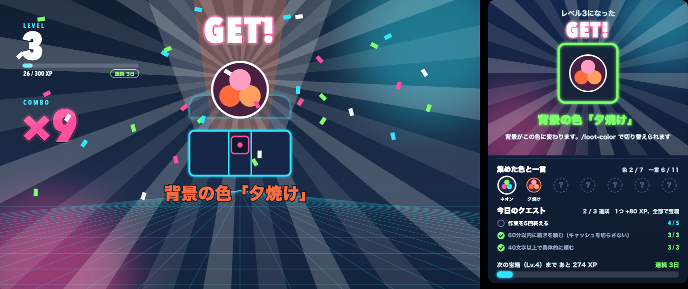
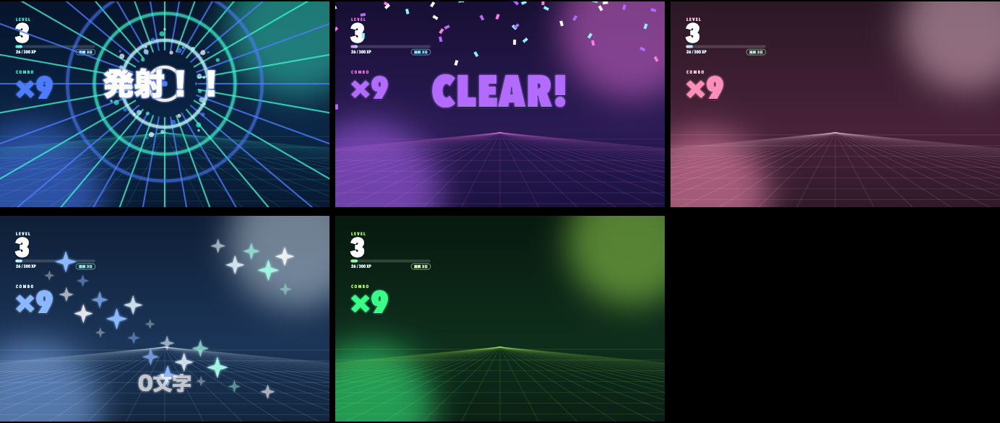

# dopa-backdrop

Claude Codeのデスクトップアプリの背景を、ゲームのような演出が出る画面に変えるmodです。
プロンプトを送るたびに発射の演出が出て、Claudeがツールを使うたびにコンボが増えます。
レベルが上がると宝箱が開き、背景の色違いが手に入ります。



上の絵と下の絵は、modが描く絵をそのまま書き出したものです。

## 起きること

| 場面 | 起きること |
|---|---|
| プロンプトを送る | 中央から光と線が広がり、「いけぇ！！」などの一言が出る |
| 入力欄に打つ | 10文字ほど打つごとに、星の火花が散る |
| Claudeがツールを使う | コンボが1増える。エラーが出ると0に戻る |
| コンボが10になる | フィーバーに入り、経験値が2倍になる |
| 作業が終わる | 「CLEAR!」と紙吹雪が出て、経験値が入る |
| 経験値が300たまる | レベルが上がり、宝箱が開く |
| Claudeが質問して待っている | 「YOUR TURN!」と出る |

経験値は、ツール1回ごとと、作業が終わったときに入ります。
ツールの12%はクリティカルになり、その回の経験値が3倍になります。
その日の最初の送信では、連続日数に応じたボーナスが入ります。

AIは呼ばないので、トークンは使いません。

## 宝箱

宝箱が開くのは、次の3つのときです。

- レベルが上がったとき
- 作業中にたまに（ツール1回につき4%、15分に1回まで）
- 今日のクエストを3つとも終えたとき

中身は、背景の色違い6種（夕焼け、深海、氷、桜、若葉、ぶどう）か、発射の一言の追加6種のどれか1つです。
色が出ると、背景がその色に変わります。
12個を全部集めたあとは、ボーナスの経験値が出ます。



## 今日のクエスト

日替わりで3つ出ます。
1つ終えると経験値が80入り、3つとも終えると宝箱が開きます。

- エラーなしで作業を終える
- 60分以内に続きを頼む
- コンボ10でフィーバーに入る
- 40文字以上で具体的に頼む
- 作業を5回終える

## 入れ方

### ターミナルで使っている場合

Claude Codeの入力欄で次の1行を実行します。

```
/plugin install dopa-backdrop --marketplace k-hide10/claude-code-plugins
```

シェルから入れる場合は次の2行です。

```
claude plugin marketplace add k-hide10/claude-code-plugins
claude plugin install dopa-backdrop@hide10
```

### デスクトップアプリで使っている場合

デスクトップアプリで`/plugin`と打つと設定の「プラグイン」画面が開きますが、この画面からは入れられません。
代わりに、新しいセッションでClaudeに次の文を送ってください。

```
Claude Code のプラグイン dopa-backdrop を入れたいです。次のとおり進めて。
1. claude コマンドがあればそれを使う。なければ、デスクトップアプリに入っている Claude Code を使う
   （~/Library/Application Support/Claude/claude-code/ の中の claude.app/Contents/MacOS/claude で、一番新しい版のもの）
2. その claude で、次の 2 つを順に実行する
   plugin marketplace add k-hide10/claude-code-plugins
   plugin install dopa-backdrop@hide10
3. plugin list で dopa-backdrop@hide10 が入ったか確かめて、結果を教えて
```

実行してよいか聞かれたら、許可してください。

どちらの場合も、入れたあとに始めたセッションから動きます。

## コマンド

| コマンド | すること |
|---|---|
| `/loot` | 右のパネル（宝箱、集めた色と一言、今日のクエスト）を開く |
| `/loot-color` | 背景を、集めた色の中で次の色に切り替える |
| `/loot-chest` | 試しに宝箱を1つ開ける |

## 保存するもの

経験値、連続日数、今日のクエストの進み、集めた色と一言を、Claude Codeがmodごとに用意している保存場所に残します。
アプリを開き直しても続きから始まります。
依頼の中身は保存せず、外へも送りません。

## 動く条件

- 背景と音は、デスクトップアプリ向けです。作者はmacOSのデスクトップアプリ（Claude Code 2.1.328）で作りました
- ターミナルでの表示は確かめていません
- modの書き方は変わることがあります。古いバージョンや新しいバージョンでは、背景が出ないことがあります

## 気をつけること

演出では、画面が強く光ったり、色がすばやく切り替わったりします。
光の点滅が苦手な人は入れないでください。

modは、使う人のパソコンの上で、その人と同じ権限で動きます。
入れる前に、`claude plugin validate` で何をするmodなのかを確認できます。

```
claude plugin validate .
```
